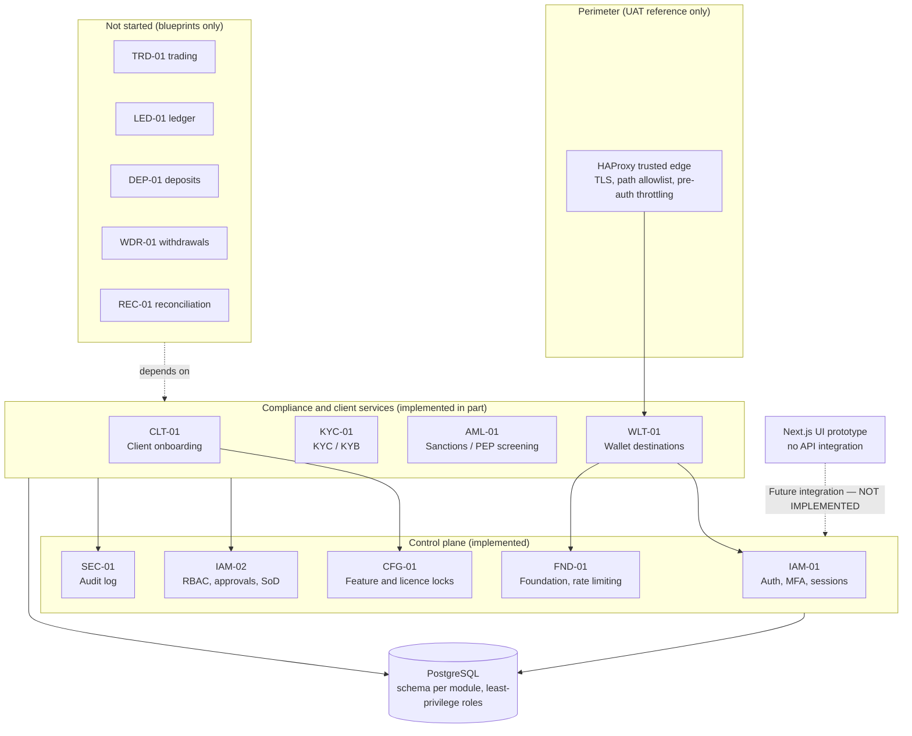
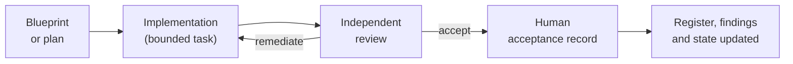

# AIX Full Compliance

**Governed financial-infrastructure software for institutional digital-asset brokerage, payments and tokenised-asset operations.**

> **Status: in active development. Not production-ready.** No regulatory approval is claimed or implied by this repository. No capability is enabled for production, no deployment is evidenced in this repository, internet exposure of public routes is prohibited by the governance record, and no client-asset ledger and no completed custody, safeguarding or settlement infrastructure has been implemented (`LED-01` is not started; the `DEC-015` architecture is a proposal that is not accepted). See [Current status](#current-status) for what exists and what does not.

> **Independent software.** This project is independently developed software. It is separate from AIX Investment Group and from any licence, authorisation or regulatory permission held by AIX Investment Group or any other entity. Nothing in this repository grants, evidences or implies a licence or regulatory approval.

---

## What this is

AIX Full Compliance is an institutional platform design and implementation built around one idea: **in regulated financial infrastructure, controls are part of the product, not an afterthought.** The repository holds both the software (`platform/`) and the governance record that constrains it (`docs/`): requirements, architecture decisions, independent reviews, acceptance records and open findings.

The target is an institution-only (institutional / high-net-worth) platform with one shared core and five product areas:

| Product area | Intended purpose | Implemented today |
|---|---|---|
| **AIX Spot** | Client orders executed through external venues and liquidity providers (agency, back-to-back) | **No.** Blueprint only; the trading module (`TRD-01`) is not started |
| **AIX OTC** | Large-size, counterparty-quoted execution via external liquidity providers | **No.** Blueprint and requirements only |
| **AIX Pay** | Institutional payments and settlement | **No.** Architecture draft only |
| **AIX RWA** | Tokenised real-world asset lifecycle | **No.** Architecture and requirements only |
| **AIX Exchange** | Securities / security-token market capability (a separate domain from Spot) | **No.** Authorised for design and build; production activation is gated |

What *is* implemented is the **shared control plane and compliance foundation** these products would sit on (identity, authorisation, audit, feature and licence locks, client onboarding, KYC/KYB, AML screening and the first wallet-destination controls), a **UAT-only perimeter reference**, and a **UI prototype with no backend integration**. Details below.

## Execution and custody model

This section separates what is **decided**, what is **implemented**, and what is only **targeted**. Trade execution, ledger, deposits, withdrawals, custody and settlement are **not implemented**, so none of their controls exist in code.

### 1. Accepted architectural rules (governance decisions, not code)

Recorded in [Licence Scope v1.5](docs/01_masters/00_Licence_Scope_And_Feature_Lock_v1.5.md) and [`DECISION_LOG.md`](docs/DECISION_LOG.md) (`DEC-011`, `DEC-012`, `DEC-013`):

- **Agency, not principal.** Execution is to be agency / back-to-back through external venues or approved liquidity providers (Model A accepted; Model B multi-venue routing accepted as production-gated).
- **No internal matching for MB Spot.** No AIX order book, client-to-client crossing or netting, proprietary market making, principal dealing, AIX principal liquidity, spread mark-up or maker/taker fees, in **every** environment including local development. Internal matching (Model C) is blocked.
- **Disclosed brokerage fee only; AIX inventory zero; third-party custody.**
- **Build-unlocked, production-gated.** Capabilities may be built and tested before activation; production activation fails closed and unknown state denies.

### 2. Safeguards that exist in code today

These are narrow and do not amount to an execution, custody or settlement control set:

- A boot-time route-path guard (`assertNoExchangeRuntime`) in all nine services that refuses prohibited route fragments. It is a string check on route paths, not a business-logic control.
- A seeded registry of prohibited features in CFG-01 (30 hard locks) that denies on evaluation, with unknown features denied.
- An environment-availability check in CFG-01 (`MIG-004`): every `environment_scope` entry defaults to disabled and there is no write path to change one.
- A default-off switch for the WLT-01 public routes.

### 3. Target behaviour (not built)

Order routing to external venues, execution recording, client ledger and balances, deposits, withdrawals, reservations, settlement and reconciliation are specified in blueprints only (`TRD-01`, `LED-01`, `DEP-01`, `WDR-01`, `REC-01` are not started). The client-asset, fiat-banking, virtual-account, custody and settlement architecture ([`DEC-015`](docs/05_strategy/AIX_Client_Asset_Fiat_Banking_Virtual_Account_Custody_Settlement_Architecture_v0.4.md)) is a **proposal under review and is not accepted**; it binds nothing.

### 4. What is not yet enforced end to end

The rules in section 1 are not yet enforced across a complete trade, custody or settlement path, because that path does not exist. No end-to-end proof that a client order cannot be internally matched, that AIX holds no inventory, or that client assets are segregated is claimed or possible until those modules are built, reviewed and accepted.

## Architecture overview



**Technology:** TypeScript on Node.js (≥ 20), Fastify services, PostgreSQL with `node-pg-migrate` migrations, per-module database schemas and least-privilege roles, a database-backed audit/outbox pattern, Vitest, and a Next.js 16 / React 19 / Tailwind CSS v4 / shadcn UI prototype. The UAT edge reference uses HAProxy.

**Design principles visible in the code:** fail-closed defaults, module-owned schemas, an explicit import-boundary control between modules, a shared audit trail, environment-aware capability gating across five environments (development, test, UAT, demo, production), and maker-checker approval workflows.

## Current status

State as verified against the repository on **2026-10-19**. The authoritative live record is [`CURRENT_STATE.md`](docs/00_project_state/CURRENT_STATE.md); where this README and that file differ, that file wins.

### Implemented and independently accepted

Each item below has a recorded independent review and acceptance record (recent tasks also record explicit human acceptance). "Accepted" means accepted *for the scope recorded*, not production-ready.

| Area | Scope accepted |
|---|---|
| FND-01 Foundation | Foundation baseline, shared rate-limit engine and hardening |
| IAM-01 | Authentication, MFA, sessions, internal session introspection |
| IAM-02 | RBAC / permission guard baseline (**approval endpoints do not yet enforce permissions**; see open findings) |
| SEC-01 | Audit log and security monitoring, through Phase 5 |
| CFG-01 | Feature and licence locks through Phase 3B, plus environment availability (`MIG-004`) |
| CLT-01 | Client onboarding core and membership authority |
| KYC-01, AML-01 | Verification and screening baselines through their recorded phases |
| WLT-01 | Wallet-destination controls and the public-surface gate (module as a whole is partial) |
| IMP-02 | UAT trusted edge, network-isolation proof, UAT TLS, measurement-harness foundation, and its hardening |

Most recent accepted work: `IMP02-MA-HARDEN-001` (`9b0bab7`), `MIG-005` canonical environment model (`5f78a0b`), `MIG-004` environment availability (`5a4f872`). The database is at migration **071**.

### UI prototype (mixed status)

- **Public homepage — visually accepted** (UI Phase 1R, recorded in [`docs/04_ui/README.md`](docs/04_ui/README.md)). A static page with no backend integration; visual acceptance says nothing about production readiness.
- **Authenticated Client, Staff/Operations and Admin pages (UI Phases 2A–2T) — implemented, not accepted.** Static and read-only with **no API or authentication integration**. Visual QA is deferred by an explicit program decision and **visual acceptance of the authenticated UI is pending**; it is not implied by this README.

### Proposed or under review (nothing here is implemented)

| Item | State |
|---|---|
| `DEC-015` client-asset / fiat / custody / settlement architecture (`STR-04` v0.4) | **NOT ACCEPTED.** Three review rounds returned *remediate*; the fourth independent review is pending |
| `ACC-01` account structure (master account and subaccount) | Blueprint v0.10 passed independent review; **on an unmerged branch**, no human acceptance, not implemented |
| `AST-01` asset and instrument registry | Blueprint v1.8 passed independent review; **on an unmerged branch**, no human acceptance, not implemented |

### Not started

Trading and execution (`TRD-01`), ledger (`LED-01`), deposits (`DEP-01`), withdrawals (`WDR-01`, blocked on a key-management prerequisite), reconciliation, incident handling, end-to-end fund-flow integration, the AIX Exchange modules, and the Pay and RWA modules.

### Known gaps that matter

| Finding | Why it matters |
|---|---|
| `FND-FIND-001` (HIGH) | Pre-authentication abuse control is proven only in a UAT harness. **Internet exposure of any public route remains prohibited** |
| `IAM2-FIND-002` (HIGH) | Approval endpoints do not yet check permissions; required before real-actor approval flows |
| `CFG-FIND-002` (MEDIUM) | Configuration integrity seal not verified at decision time for feature records |
| `WDR-FIND-001` (blocked) | Withdrawals blocked on key management |

The full register is [`OPEN_FINDINGS.md`](docs/OPEN_FINDINGS.md).

## Governance and review process

Software here is built under a documentation-first, review-gated process. The repository is the single source of truth.



- **Review is separated from authorship.** Reviews are run apart from the author and the author's report is treated as an assertion, not evidence. Each record states its level of independence (some are independent in context only, not in model).
- **Acceptance is a human act.** A model cannot mark work accepted; acceptance needs a recorded human decision and repository evidence (commit and reproduced result).
- **Findings are closed on evidence only,** never on a report that something was fixed.
- **Historical records are never rewritten.** Superseded document versions are retained.
- **Decisions are logged** in [`DECISION_LOG.md`](docs/DECISION_LOG.md); document versions are owned by [`DOCUMENT_REGISTER.md`](docs/DOCUMENT_REGISTER.md); unresolved findings by [`OPEN_FINDINGS.md`](docs/OPEN_FINDINGS.md).

## Roadmap

Only items the repository records as next or open. Priorities and order are decided by the project owner; there are **no dates** because none are committed.

1. **Governance:** independent Round-4 review of the `DEC-015` architecture, then a human acceptance decision.
2. **Blueprints:** the AIX Exchange modules, then account structure (`ACC-01`) and asset registry (`AST-01`) decisions on merging and acceptance.
3. **Control hardening:** approval-endpoint authorisation (`IAM2-FIND-002`) and configuration-seal verification (`CFG-FIND-002`).
4. **Perimeter:** production deployment proof, TLS lifecycle and capacity measurement under IMP-02 before any internet exposure.
5. **UI:** the remaining Admin area (Audit / Sensitive Access), then a consolidated visual QA pass.
6. **Money tier:** ledger, deposits, withdrawals, trading and reconciliation, each only after its architecture prerequisites are accepted.

## Repository layout

```text
docs/                   Governance record (start at docs/README.md)
  00_project_state/     Current state, module status, handover
  01_masters/           Authoritative master documents (licence scope, charter, SRS, ...)
  02_modules/           Per-module blueprints, reviews, acceptance records
  03_implementation/    Implementation packs and conductor task records
  04_ui/                UI design governance
  05_strategy/          Architecture analysis and proposals (no authority over masters)
  90_archive/           Superseded versions (retained)
platform/               Implementation monorepo (npm workspaces)
  packages/foundation   Shared foundation package
  services/             Nine Fastify services
  apps/web/             Next.js UI prototype
  edge/                 UAT trusted-edge reference
  perf/                 Capacity-measurement harness
  infra/                Migrations and database grants
```

## Documentation map

| Need | Document |
|---|---|
| Where things stand right now | [`docs/00_project_state/CURRENT_STATE.md`](docs/00_project_state/CURRENT_STATE.md) |
| Module-by-module implementation status | [`docs/00_project_state/MODULE_STATUS.md`](docs/00_project_state/MODULE_STATUS.md) |
| Which document versions are authoritative | [`docs/DOCUMENT_REGISTER.md`](docs/DOCUMENT_REGISTER.md) |
| Unresolved findings and blockers | [`docs/OPEN_FINDINGS.md`](docs/OPEN_FINDINGS.md) |
| Why decisions were made | [`docs/DECISION_LOG.md`](docs/DECISION_LOG.md) |
| Licence scope and capability model | [`docs/01_masters/00_Licence_Scope_And_Feature_Lock_v1.5.md`](docs/01_masters/00_Licence_Scope_And_Feature_Lock_v1.5.md) |
| Module index (37 modules) | [`docs/01_masters/03_Master_Module_Index_v1.4.md`](docs/01_masters/03_Master_Module_Index_v1.4.md) |
| Task and acceptance records | [`docs/03_implementation/tasks/`](docs/03_implementation/tasks/README.md) |
| Perimeter / deployment work | [`docs/03_implementation/IMP-02/README.md`](docs/03_implementation/IMP-02/README.md) |
| Documentation entry point | [`docs/README.md`](docs/README.md) |

## Working with the code

Requires Node.js 20+ and PostgreSQL. From `platform/`:

```bash
npm install
npm run typecheck      # tsc -b
npm test               # vitest; database tests need TEST_DATABASE_URL
npm run migrate:up     # needs DATABASE_URL
```

See [`platform/README.md`](platform/README.md) for layout and conventions. Secrets belong in environment variables; use `platform/.env.example` as the template and never commit real credentials.

## Disclaimer

This repository is software and documentation under development. It is not financial, legal, regulatory or investment advice, and it is not an offer of any financial product or service. References to regulatory frameworks describe design intent only. The authors make no claim of licensing, regulatory approval, operational readiness, security certification or production deployment.
